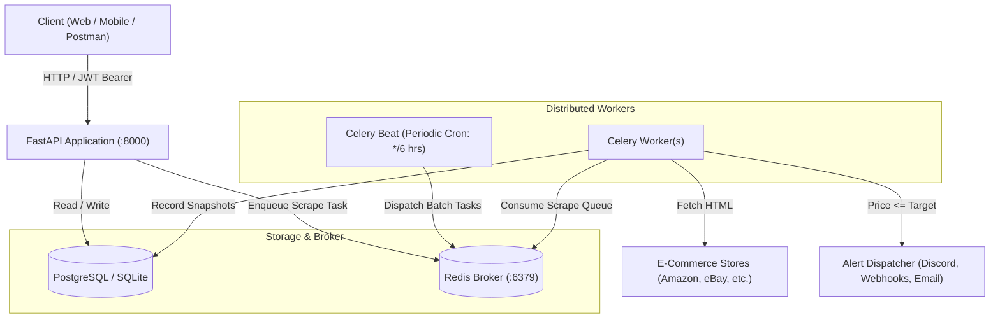

# 🏷️ Multi-Tenant E-Commerce Price Tracking & Alert API

A production-grade Python backend engine for tracking e-commerce product prices across multiple platforms (e.g. Amazon, eBay), polling historical price snapshots asynchronously via distributed task queues, enforcing multi-tenant subscription quotas, and dispatching event-driven alerts.

---

## 🏗️ System Architecture



---

## 💡 Engineering Highlights: Real-World Problems Solved

### 1. Catalog Deduplication (Decoupled User Tracking vs. Canonical Product)
* **Problem**: If 1,000 users track the exact same Amazon headphones, scraping Amazon 1,000 times will get your server's IP banned within minutes.
* **Solution**: Normalizes query/affiliate parameters (`normalize_url`) and decouples `Product` from `TrackedItem`. The product is scraped **once**, and all 1,000 user alert thresholds are evaluated in a single database pass.

### 2. Multi-Tenant Tier Quotas
* **Problem**: Free tier users exhausting server resources and worker capacity.
* **Solution**: Database-backed quota validation middleware. `FREE` users can track up to 5 items; `PREMIUM` users can track up to 50 items. Requests exceeding limits are rejected with `403 Forbidden`.

### 3. Strategy Pattern for Extensible Scraping
* **Problem**: Different stores have radically different HTML structures and anti-scraping protections.
* **Solution**: `BaseScraper` strategy interface (`can_handle()` + `parse()`). Allows adding support for new stores (Walmart, BestBuy) in isolation without modifying core ingestion logic.

### 4. Alert Fatigue Prevention (24-Hour Cooldown)
* **Problem**: Once a price drops below a threshold, periodic polling would spam the user with an email every 6 hours.
* **Solution**: Timestamp-based cooldown mechanism (`last_notified_at`). Alerts fire immediately upon price drop, then enforce a 24-hour mute window until either the price rises and drops again or the cooldown expires.

### 5. Time-Series Analytics & Indexing
* **Problem**: Calculating historical min/max and rendering price charts over millions of snapshots causes full table scans.
* **Solution**: Composite B-Tree index on `(product_id, recorded_at)`. Analytical endpoints compute all-time low, high, average, and price drop percentages with sub-millisecond lookups.

---

## 🛠️ Tech Stack

* **Framework**: FastAPI (Python 3.11+)
* **Database & ORM**: SQLAlchemy 2.0 + SQLite (Local) / PostgreSQL (Docker)
* **Task Queue & Broker**: Celery + Redis
* **Validation & Settings**: Pydantic v2 + Pydantic-Settings
* **Auth**: JWT (PyJWT) + Bcrypt
* **HTTP & Scraping**: HTTPX + BeautifulSoup4
* **Testing**: Pytest (100% test pass rate with in-memory SQLite isolation)
* **Containerization**: Docker & Docker Compose

---

## 🔌 API Endpoints

### 🔐 Authentication
| Method | Endpoint | Description |
| :--- | :--- | :--- |
| `POST` | `/api/v1/auth/register` | Register new account (`FREE` or `PREMIUM`) |
| `POST` | `/api/v1/auth/login` | OAuth2 login, returns signed JWT access token |
| `GET` | `/api/v1/auth/me` | Fetch authenticated user profile & quota limit |

### 📦 Tracked Items
| Method | Endpoint | Description |
| :--- | :--- | :--- |
| `POST` | `/api/v1/tracked-items` | Ingest product URL, scrape immediately, link to user |
| `GET` | `/api/v1/tracked-items` | List user's tracked watchlist with latest prices |
| `GET` | `/api/v1/tracked-items/{id}` | Get single tracked item details |
| `PATCH` | `/api/v1/tracked-items/{id}` | Update target price, notification channel, or pause |
| `DELETE` | `/api/v1/tracked-items/{id}` | Remove product from watchlist |

### 📈 Analytics & Background Tasks
| Method | Endpoint | Description |
| :--- | :--- | :--- |
| `GET` | `/api/v1/analytics/products/{id}/history` | Time-series price points, min/max/avg, all-time-low |
| `POST` | `/api/v1/analytics/trigger-poll` | Manually trigger Celery background polling batch |

---

## 🚀 Quickstart

### Option 1: Run with Docker Compose (Recommended)
Spins up PostgreSQL, Redis, FastAPI API, Celery Worker, and Celery Beat scheduler with one command:

```bash
docker-compose up --build
```
* **Interactive Swagger UI**: [http://localhost:8000/docs](http://localhost:8000/docs)
* **API Health Check**: [http://localhost:8000/health](http://localhost:8000/health)

### Option 2: Run Locally with Python Virtual Environment
```bash
# 1. Activate your virtual environment
source .venv/bin/activate

# 2. Start the FastAPI development server
uvicorn app.main:app --reload --port 8000

# 3. (Optional) Run Celery background worker
celery -A app.workers.celery_app.celery_app worker --loglevel=info
```

---

## 🧪 Running Automated Tests

Run the test suite using `pytest`:
```bash
pytest tests/ -v
```
All 5 comprehensive test suites cover:
* Authentication & JWT verification
* URL normalization & product deduplication
* Quota limit enforcement
* Alert threshold & cooldown dispatching
* Time-series chart calculations
